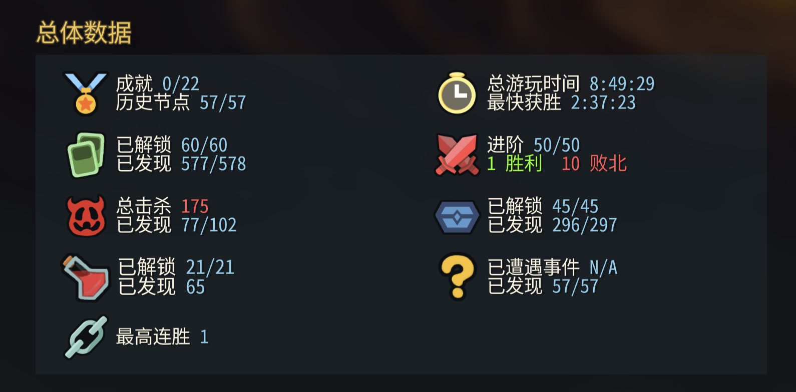

# Slay the Spire 2 — Unlock Everything

[中文](README.md) | **English**



One script that unlocks the whole compendium, every timeline epoch, all game modes, and every ascension level in **Slay the Spire 2**.

**It only edits the save file on your computer. It does not modify the game and is not a mod.**

> ⚠️ This is an unofficial, fan-made tool and is not affiliated with Mega Crit. "Slay the Spire" and the in-game imagery in the screenshot are © Mega Crit. Editing saves is at your own risk; the script backs everything up before it writes.

Tested against game version **v0.107.1**. For other versions, see "The game updated" below.

---

## What gets unlocked

| Item | After running |
|---|---|
| Cards | All 577 |
| Relics | All 296 |
| Potions | All 63 |
| Events | All |
| Timeline (epochs) | All 57 |
| Characters | All 5 (including the Defect) |
| Single-player modes | **Daily** and **Custom / Seeds** |
| Ascension | Level 10 for every character, and 10 in multiplayer |

**Not touched**: Steam achievements, win/loss stats, run history, the bestiary.

> Seeing 577/578 cards and 296/297 relics in-game afterwards is expected. The missing one in each is a "deprecated" placeholder that still exists in the game code but can never be obtained.

---

## Requirements

**Python 3.8 or newer.**

- **macOS**: open Terminal and run `python3 --version`. If macOS asks to install the Command Line Developer Tools, accept, then run the command again.
- **Windows**: install from <https://www.python.org/downloads/>. On the first installer screen, **check "Add python.exe to PATH"**. Then run `py --version` in Command Prompt to confirm.

Download with the green **Code → Download ZIP** button on this page. After unzipping, keep `sts2_unlock_all.py` and `sts2_ids.json` in the same folder.

---

## How to use

### 1. Play the game at least once

The script edits an existing save, so a fresh install needs one launch first.

- If you usually play **with mods**, launch once with mods.
- If you usually play **without mods**, launch once normally.

Modded and vanilla play use **two separate saves**. Unlock the one you actually play, or both.

### 2. Fully quit the game and Steam ⚠️

This is the most important step.

- **macOS**: menu bar Steam → Quit Steam (or ⌘Q). Closing the window is not enough.
- **Windows**: right-click the Steam icon in the system tray → Exit.

The script checks for this and refuses to run while Steam or the game is open.

### 3. Open a terminal in this folder

- **macOS**: open Terminal, type `cd ` (with a trailing space), drag this folder into the window, press Enter.
- **Windows**: open this folder, type `cmd` in the address bar, press Enter.

### 4. Run the script

**macOS:**

```bash
python3 sts2_unlock_all.py
```

**Windows:**

```bat
py sts2_unlock_all.py
```

It lists the saves it found, for example:

```
Found these saves:
  [1] modded save  modded/profile1/saves/progress.save  (Steam 7656...)  cards 232/577, relics 105/296, epochs 14/57
  [2] vanilla save  profile1/saves/progress.save  (Steam 7656...)  cards 200/577, relics 87/296, epochs 13/57

Which ones to unlock? Enter numbers (comma-separated), or press Enter for all:
```

Type a number (e.g. `1`) and press Enter, or just press Enter to unlock all of them.

The script **backs up first**, then writes. Backups go into the `backups/` folder next to the script.

> Add `--dry-run` to preview the changes without writing anything. Output follows your system language; force it with `--lang en` or `--lang zh`.

### 5. Start Steam and wait ~15 seconds

This gives Steam time to upload the new save to the cloud.

If Steam shows a **cloud sync conflict**, choose **the local files (this computer)**, not the cloud.

### 6. Launch the game and check

Open the compendium, the single-player mode menu and character select to confirm everything is unlocked.

---

## Undo

When it finishes, the script prints where the backup is, e.g. `backups/20261017-211204`. Fully quit Steam and the game, then run:

**macOS:**

```bash
python3 sts2_unlock_all.py --restore backups/20261017-211204
```

**Windows:**

```bat
py sts2_unlock_all.py --restore backups\20261017-211204
```

---

## FAQ

**"Please fully quit Steam and the game first"**

Steam is still running in the background. Quit it as in step 2. If it won't go away, restart your computer.

**"No progress.save found"**

- Launch the game once, then quit.
- If your saves live somewhere else, pass `--save-root`. The default locations are:
  - macOS: `~/Library/Application Support/SlayTheSpire2`
  - Windows: `%APPDATA%\SlayTheSpire2`
  - Linux: `~/.local/share/SlayTheSpire2`

**"⚠ Steam cloud cache not found"**

The script couldn't find Steam's cloud-save cache. Either Steam Cloud is turned off for the game, or Steam is installed somewhere unusual.

- Steam Cloud is off: nothing to do, it works as is.
- Steam is installed elsewhere: pass `--steam-root "path/to/Steam"`. Otherwise the game may overwrite your unlock with the old cloud copy at launch.

**Everything got reset after launching**

Almost always, Steam was still running when you ran the script, so the game pulled the old cloud save over your local one at launch. Fully quit Steam and run the script again.

**Can I get banned?**

There are no known cases of bans for editing saves, and Mega Crit has said they don't plan to add invasive anti-cheat. This script only changes your own single-player progress and never touches achievements or leaderboards. Mega Crit has not published an explicit policy on this, though, so **use at your own risk**.

**The game updated**

New versions may add cards or relics. With an old ID list the script still works; it just won't unlock the new content. To refresh the list:

```bash
pip install dnfile
python3 sts2_unlock_all.py --dll "path/to/sts2.dll"
```

`sts2.dll` is in the game install folder:
- macOS: `SlayTheSpire2.app/Contents/Resources/data_sts2_macos_arm64/sts2.dll`
- Windows: something like `data_sts2_windows_x86_64\sts2.dll` in the game folder (check the actual folder name)

**Supported systems**

Tested on macOS. The Windows and Linux paths follow the same conventions but **haven't been tested yet**. If something goes wrong, use `--save-root` and `--steam-root` to point at the right folders.

---

## How it works

1. **The save is JSON.** `progress.save` is plain JSON text.
   - What the compendium shows comes from lists like `discovered_cards`.
   - Whether an epoch, mode or character is unlocked depends on whether that entry in `epochs` has `state` set to `revealed`.
   - Ascension comes from `character_stats[].max_ascension`.
2. **IDs come from the game itself.** `sts2_ids.json` is built from class names in the game's .NET assembly `sts2.dll`.
   - For example, `MegaCrit.Sts2.Core.Models.Cards.StrikeIronclad` becomes `CARD.STRIKE_IRONCLAD`.
   - The localization files contain stale entries, so they aren't used.
3. **The Steam Cloud trap.** At launch, the game copies the Steam Cloud version over the local save, even when the local one is newer.
   - That "cloud" copy actually lives in Steam's local cache at `Steam/userdata/<account id>/2868840/remote/`.
   - So the script edits that cache **and** the local save while Steam is closed. When Steam starts, it sees the changed files and uploads them.

## License

[MIT](LICENSE)
